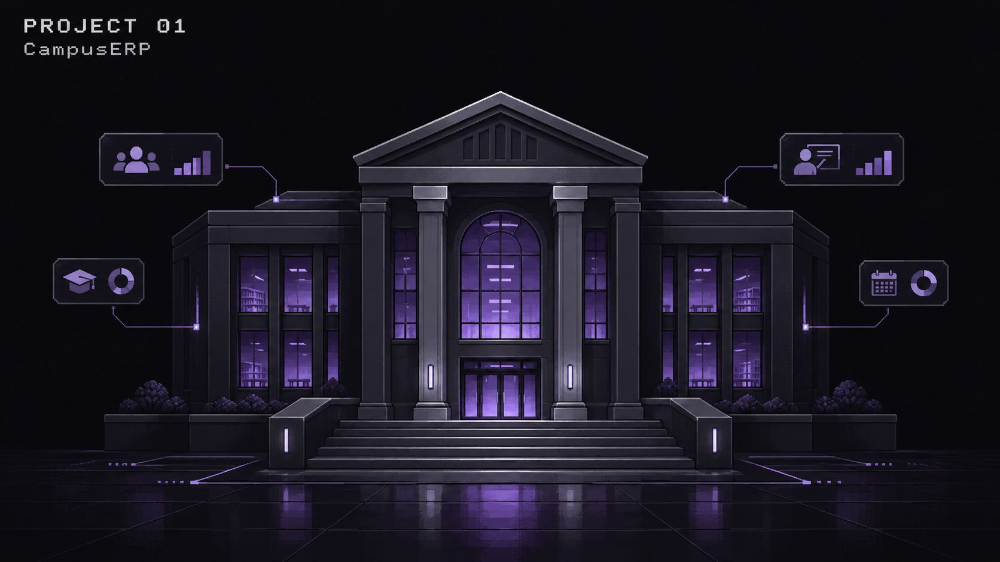

# 👾 Hey, I'm Sunil P!

<p align="center">
  
</p>

<p align="center">
  
</p>

<p align="center">
<a href="https://sunilp2109.vercel.app/"></a>
<a href="https://linkedin.com/in/sunilp2109"></a>
<a href="https://tryhackme.com/p/sunilp21092005"></a>
<a href="mailto:sunilp21092005@gmail.com"></a>
</p>


## ✦ About Me

```text
> Cybersecurity enthusiast
> UI/UX designer
> Ethical hacking & CTF learner
> Interested in secure and intuitive digital experiences
```

I'm a Cybersecurity student passionate about penetration testing, ethical hacking, and building secure, user-focused applications.

I enjoy exploring vulnerabilities, solving CTF challenges, designing intuitive interfaces, and turning ideas into meaningful digital experiences.

- 🔐 Exploring cybersecurity, penetration testing & web security
- 🎨 Designing interfaces and prototypes with Figma
- 💻 Working with C, Java, Python & web technologies
- 🧠 Constantly learning through CTFs and hands-on labs
- 🚀 Interested in the intersection of security, design & technology


## ⚡ Tech Stack

### 💻 Programming & Web

<p>
  
</p>

### 🔐 Cybersecurity

<p>
  
  
  
  
  
  
  
</p>

### 🎨 Design & Development Tools

<p>
  
</p>


## 🚀 Featured Projects

<table>
  <tr>
    <td width="50%" valign="top">
      
      <h3>CampusERP</h3>
      <p>Unified academic management experience.</p>
    </td>
    <td width="50%" valign="top">
      
      <h3>Phylax</h3>
      <p>Network protection and security.</p>
    </td>
  </tr>
  <tr>
    <td width="50%" valign="top">
      
      <h3>SecuShare</h3>
      <p>Blockchain-based secure file sharing.</p>
    </td>
    <td width="50%" valign="top">
      
      <h3>QR Canteen</h3>
      <p>Smart digital ordering experience.</p>
    </td>
  </tr>
</table>


## 🏆 Achievements

| Achievement | Recognition |
|---|---|
| 🥇 Zero Day CTF | 1st Place – 2025 |
| 🥈 Innothon'25 | Runner-Up – 2nd among 100+ teams |
| 🔥 TryHackMe | Top 6% globally – 2026 |
| 🧩 CTF Challenges | Active participant – 2024–2026 |


## 📜 Certifications & Learning

- **Penetration Testing** – Datayaan Solutions Pvt. Ltd. (76-hour program, Outstanding Performance)
- **Introduction to Networking** – CCNA
- **Cyber Job Simulation** – Deloitte (Forage)
- **Advent of Cyber 2025** – TryHackMe


## 🎓 Education

**Bachelor of Engineering – Computer Science & Engineering (Cyber Security)**

KCG College of Technology, Chennai

- CGPA: 8.3
- 2023 – Present


## 📊 GitHub Stats

<p align="center">
  
  
</p>

<p align="center">
  
</p>


## 🌐 Let's Connect

<p align="center">
  <a href="https://sunilp2109.vercel.app/">Portfolio</a> •
  <a href="https://linkedin.com/in/sunilp2109">LinkedIn</a> •
  <a href="https://tryhackme.com/p/sunilp21092005">TryHackMe</a> •
  <a href="mailto:sunilp21092005@gmail.com">Email</a>
</p>

<p align="center">
  <i>"Security is not just about protecting systems — it's about building trust through thoughtful design."</i>
</p>

<p align="center">
  
</p>
