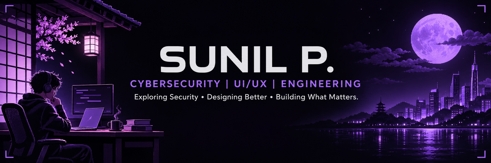
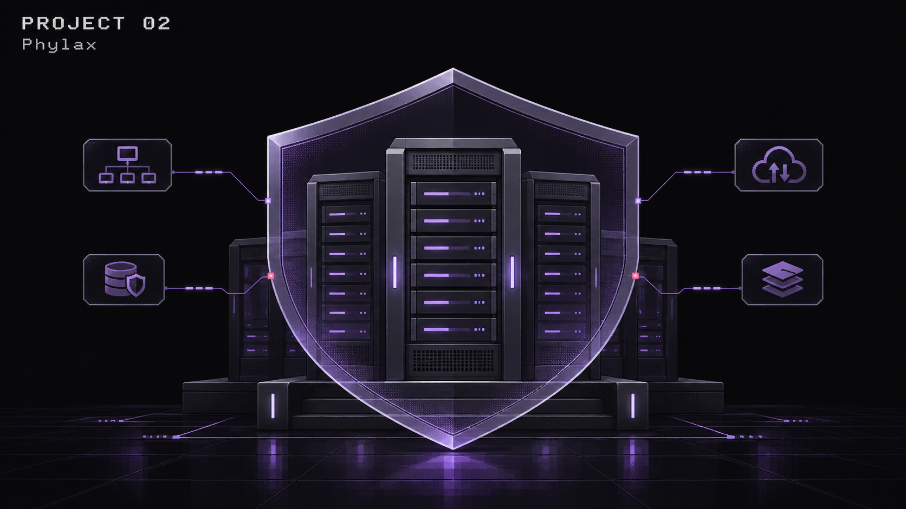
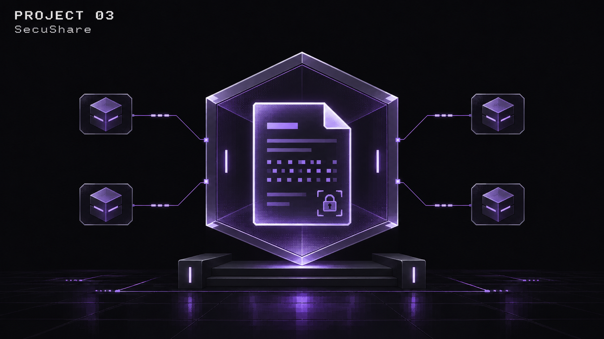
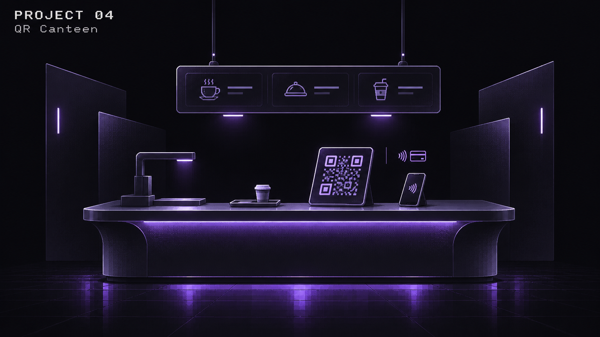

# Sunil P.

  

  

  <a href="https://sunilp2109.vercel.app/"><strong>Portfolio</strong></a> &nbsp;·&nbsp; <a href="https://sunilp2109.vercel.app/resume.pdf">Résumé</a> &nbsp;·&nbsp; <a href="https://www.linkedin.com/in/sunilp2109/">LinkedIn</a> &nbsp;·&nbsp; <a href="https://tryhackme.com/p/sunilp21092005">TryHackMe</a> &nbsp;·&nbsp; <a href="mailto:sunilp21092005@gmail.com">Email</a>

## About

I’m a cybersecurity engineering student and UI/UX designer. I practice web and network security through ethical hacking labs and CTFs, and I use Figma to prototype workflows for people with different roles. My campus ERP work brings those interests together around a practical design question: what should each person be able to see and do?

## Featured projects

<table>
  <tr>
    <td width="50%" valign="top">
      
      <h3>CampusERP</h3>
      
Role-based dashboards and a shared component system bring fragmented campus workflows into one interface.

      
<strong>Figma · Interactive prototypes · Design systems</strong>

      
<a href="https://sunilp2109.vercel.app/projects/campuserp">Case study</a> · <a href="https://www.figma.com/design/TdcgL8JhtXaVfizKnPSQax/ERP---DEAN-ACADEMIC">Figma design</a>

    </td>
    <td width="50%" valign="top">
      
      <h3>Phylax</h3>
      
A server-defense project focused on live packet visibility, suspicious IP tracking, and firewall-based denial-of-service mitigation.

      
<strong>Python · Packet monitoring · Firewall controls</strong>

      
<a href="https://github.com/sunilp2109/PHYLAX">GitHub fork</a>

    </td>
  </tr>
  <tr>
    <td width="50%" valign="top">
      
      <h3>SecuShare</h3>
      
A secure file-sharing project that explores using a decentralized transfer record to make changes to file-sharing history detectable.

      
<strong>Blockchain · File integrity · Transfer records</strong>

    </td>
    <td width="50%" valign="top">
      
      <h3>QR Canteen</h3>
      
A scan-to-order flow that brings the menu and cashless payment to diners’ phones, designed to reduce queues and manual billing.

      
<strong>Mobile UI/UX · QR ordering · Payment flow</strong>

      
<a href="https://sunilp2109.vercel.app/projects/qr-canteen">Case study</a>

    </td>
  </tr>
</table>

**Also exploring**

- [Intelligent IDS](https://github.com/sunilp2109/Intelligent-IDS) · Final-year engineering project exploring interpretable machine learning for network intrusion detection.
- [Nuclei](https://sunilp2109.vercel.app/projects/nuclei) · A Figma concept that brings EV charger discovery, reservation, and payment into one mobile flow.

## Security practice

I practice web application testing, vulnerability assessment, and network analysis in labs and CTFs. My toolkit includes Burp Suite and Gobuster for web testing, Nmap and Wireshark for network analysis, and Kali Linux for lab work. I also practice with Metasploit, Shodan, and the Social-Engineer Toolkit.

- **First place · Zero Day CTF**, 2025
- **Runner-up · Innothon ’25**, second among 100+ teams
- **Top 6% worldwide · [TryHackMe](https://tryhackme.com/p/sunilp21092005)**, 2026
- **CTF participation**, 2024–2026

## Technology stack

- **Programming** · C, Java, Python
- **Web and data** · HTML, CSS, JavaScript, SQL
- **Design** · Figma, wireframing, interactive prototyping, design systems
- **Development environments** · Kali Linux, macOS, Windows

## Training

- **Penetration Testing Certification** · Datayaan Solutions Pvt. Ltd. · 76-hour program with Outstanding Performance recognition
- **Cyber Job Simulation** · Deloitte via Forage
- **Advent of Cyber 2025** · TryHackMe · 24 hands-on challenges completed
- **Introduction to Networking** · Training in routing, switching, and network security fundamentals

## Education

**B.E. in Computer Science and Engineering (Cyber Security)** 
KCG College of Technology, Chennai · 2023–present · CGPA 8.3

---

  <em>Design the interaction. Consider the trust it asks for.</em>

